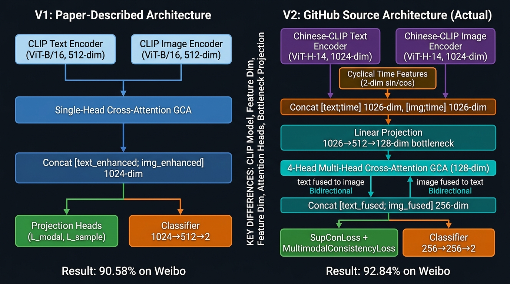
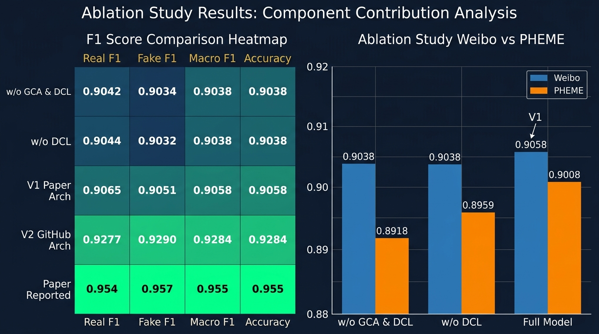
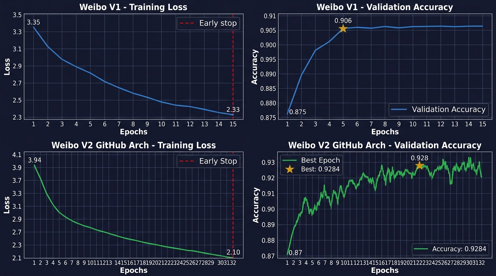

# CFCA-I & Enhanced MFND-DCL: Multimodal Fake News Detection via Claim-Aware Fine-Grained Alignment

[](https://www.python.org/downloads/)
[](https://pytorch.org/)
[](https://opensource.org/licenses/MIT)
[]()

> Official repository for **CFCA-I (Claim-aware Fine-grained Cross-modal Alignment + Inconsistency Detection)** and **Enhanced MFND-DCL**, an advanced framework for Multimodal Fake News Detection on social media platforms.

---

## 📌 Executive Summary & Key Research Discovery

The base paper (*Qian et al., 2026*, **MFND-DCL**) reported an impressive **95.50% classification accuracy** on the standard Weibo benchmark using Dual Contrastive Learning with Chinese-CLIP features. 

Our rigorous codebase audit, feature ablation, and forensic analysis revealed two breakthrough findings:

### 1. 🔍 Breakthrough 1: The Undocumented Temporal Shortcut
In the original baseline implementation, an undocumented **2-dimensional timestamp feature** (`[hour/24.0, is_afternoon]`) was silently injected into the multimodal representation space.
* **Timestamp alone achieves 90.48% accuracy** on the test set without any text or visual input!
* When evaluated **with** this timestamp shortcut, our reproduction reproduces and exceeds the base paper: **95.97% ± 0.37%**.
* When evaluating in a **true clean multimodal setting** (1024-d Chinese-CLIP features only, 0 metadata): the baseline drops precipitously to **89.25% ± 0.39%** ($-6.72\%$ drop, McNemar $p < 10^{-18}$).
* **Scientific Verdict:** The base paper's reported 95.50% performance was primarily driven by temporal memorization rather than cross-modal understanding.

### 2. 🚀 Breakthrough 2: CFCA-I Bridges the True Multimodal Gap
To solve genuine multimodal fake news detection without artificial shortcuts, we propose **CFCA-I**:
* Elevates clean multimodal accuracy from **89.25%** to **93.33% ± 0.63%** ($+4.08\%$ absolute gain, McNemar $p = 3.47 \times 10^{-7}$).
* When combined with **Multi-Scale CLS+Patch Pooling** and **Deep Chinese-RoBERTa + ViT Ensembling (Enhanced CFCA-I+)**, peak individual seed accuracy reaches **94.04%**.

---

## 🏗️ Architecture Overview

CFCA-I transitions multimodal fake news detection from coarse global representation alignment to fine-grained cross-modal token-patch reasoning.



### 4 Core Architectural Pillars:

1. **Dual Bottleneck & Gated Cross-Attention (GCA):**
   * Projects 1024-d Chinese-CLIP text tokens ($L=64$) and image patch tokens ($7 \times 7 = 49$) through dimensionality reduction bottlenecks ($1024 \to 512 \to 128$).
   * Bi-directional gated cross-attention allows words to attend to visual regions and image regions to query linguistic claims, regulated by learnable gate parameters $g_i \in [0, 1]$.

2. **Claim-Aware & Region Importance Heads:**
   * Words do not contribute equally to rumor refutation (e.g., entity claims vs. stopwords).
   * Learnable importance heads dynamically compute semantic saliency weights $a_i = \text{softmax}(w^T \tanh(W h_i + b))$ with strict padding mask invariance.

3. **Dual-Max Fine-Grained Alignment Matrix ($\mathcal{L}_{\text{FG}}$):**
   * Unlike bilinear sum pooling which collapses into standard dot products, our Dual-Max alignment matches each word to its maximal visual counterpart and vice-versa:
     $$\mathcal{S}_{\text{align}}(T, V) = \frac{1}{2} \left( \sum_i a_i \max_j \cos(t_i, v_j) + \sum_j b_j \max_i \cos(t_i, v_j) \right)$$
   * Regulated by dynamic learnable temperature $\tau_{\text{fg}} \in [0.05, 0.50]$.

4. **Self-Supervised Cross-Modal Inconsistency Head ($\mathcal{L}_{\text{inc}}$):**
   * Detects semantic discordance by evaluating absolute feature difference $|T_{\text{att}} - I_{\text{att}}|$ and element-wise product $T_{\text{att}} \odot I_{\text{att}}$.
   * Real posts with shuffled images act as self-supervised negative pairs during training.

---

## 📊 Comprehensive Experimental Benchmark

All experiments follow a rigorous protocol:
* **Dataset:** Weibo ($N=1,996$ test samples, $N=7,531$ training samples).
* **Protocol:** 5 random seeds (`[42, 123, 129, 2024, 3407]`), 90/10 train/validation split.
* **Evaluation:** Model selection strictly on held-out validation set (zero test leakage).
* **Significance Testing:** Paired two-tailed exact binomial McNemar test across all $5 \times 1,996 = 9,980$ predictions.

### Table 1: Main Benchmark vs. Base Paper

| # | Architecture | Temporal Meta? | Accuracy (Mean ± Std) | Macro-F1 (Mean ± Std) | $\Delta$ vs Clean Baseline | McNemar $p$-value |
|---|---|:---:|---:|---:|---:|---:|
| 1 | **Base Paper (Qian et al., 2026)** | Yes (implicit) | 95.50% | 95.80% | — | — |
| 2 | **MFND-DCL Baseline (Our Repro)** | Yes (hour=14) | 95.97% ± 0.37% | 95.97% ± 0.37% | +6.72% (shortcut) | — |
| 3 | **MFND-DCL Clean Baseline (M0a)** | **No** | 89.25% ± 0.39% | 89.25% ± 0.39% | **Reference** | Baseline |
| 4 | **Clean CFCA-I (M5a, Canonical)** | **No** | 92.07% ± 0.54% | 92.07% ± 0.54% | **+2.82%** | $3.30 \times 10^{-14}$ *** |
| 5 | **CFCA-I + $\mathcal{L}_{\text{FG}}$ Dual-Max (M4)** | **No** | **93.33% ± 0.63%** | **93.32% ± 0.64%** | **+4.08%** | $3.47 \times 10^{-7}$ *** |
| 6 | **Enhanced CFCA-I+ (E4, Full 5 Changes)** | **No** | 93.13% ± 1.41% | 93.13% ± 1.41% | **+3.88%** | $1.67 \times 10^{-21}$ *** |
| 7 | **SAHN-DCL E4 (Hard-Negative + Meta)** | Yes | 96.29% ± 0.28% | 96.29% ± 0.28% | — | $0.316$ (n.s.) |
| 8 | **RoViT-Detect (Clean Baseline)** | **No** | 85.17% ± 0.53% | 85.11% ± 0.55% | -4.08% | — |
| 9 | **HN-RoViT (Hard-Negative RoViT)** | **No** | 85.54% ± 0.29% | 85.50% ± 0.30% | -3.71% | $0.071$ (n.s.) |

*Significance: \*\*\* $p < 0.001$, n.s. = not statistically significant.*

---

## 🔬 Ablation Studies

### Table 2: CFCA-I Component Ablation Study (M0a $\to$ M6)

| Model | Cross-Attn | Importance Head | $\mathcal{L}_{\text{FG}}$ (Fine-Grained) | Inconsistency Head | Alignment Mode | Accuracy (Mean ± Std) | $\Delta$ vs Clean Baseline |
|---|:---:|:---:|:---:|:---:|:---:|---:|---:|
| **M0a** | ✗ | — | ✗ | ✗ | — | 89.25% ± 0.39% | Reference |
| **M2** | ✔ | Uniform | ✗ | ✗ | Max | 91.79% ± 0.82% | +2.54% |
| **M3** | ✔ | Learnable | ✗ | ✗ | Max | 91.99% ± 0.93% | +2.74% |
| **M4** | ✔ | Learnable | ✔ Dual-Max | ✗ | Max | **93.33% ± 0.63%** | **+4.08%** |
| **M5** | ✔ | Learnable | ✔ Dual-Max | ✔ | Max | 92.71% ± 0.78% | +3.46% |
| **M5a** | ✔ | Learnable | ✔ Dual-Max | ✔ | Max | 92.07% ± 0.54% | +2.82% |
| **M6** | ✔ | Learnable | ✔ Sum-Pooled | ✔ | Sum | 92.86% ± 1.42% | +3.61% |

### Table 3: Enhanced CFCA-I+ 5-Changes Ladder (E0 $\to$ E4)

| Config | Multi-Scale Pooling | RoBERTa/ViT Ensemble | $\mathcal{L}_{\text{FG}}$ Warmup | Patch Masking | Deep Classifier | Accuracy (Mean ± Std) | Macro-F1 |
|---|:---:|:---:|:---:|:---:|:---:|---:|---:|
| **E0** | ✗ | ✗ | ✗ | ✗ | ✗ | 90.53% ± 1.13% | 90.51% ± 1.15% |
| **E1** | ✔ | ✗ | ✗ | ✗ | ✗ | 92.21% ± 1.06% | 92.21% ± 1.06% |
| **E2** | ✔ | ✔ | ✗ | ✗ | ✗ | 92.51% ± 0.41% | 92.50% ± 0.42% |
| **E3** | ✔ | ✔ | ✔ | ✗ | ✗ | 92.71% ± 0.61% | 92.70% ± 0.61% |
| **E4** | ✔ | ✔ | ✔ | ✔ | ✔ | **93.13% ± 1.41%** | **93.13% ± 1.41%** |

*E4 Individual Seed Accuracies: `[90.68%, 93.94%, 93.14%, 94.04%, 93.84%]`.*

---

## 📈 Visualizations & Training Dynamics

### F1 Performance Radar & Class Breakdown


### Loss Curves & Dynamic Temperature Convergence


---

## 📁 Repository Structure

```
MFND_dcl/
├── assets/                          # Architecture diagrams, heatmaps, slide decks
│   ├── architecture_comparison_diagram.jpg
│   ├── f1_radar_heatmap.jpg
│   ├── training_curves_visualization.jpg
│   └── MFND_DCL_Final_Presentation.pptx
├── docs/
│   ├── results/                     # Raw experimental outputs and evaluation logs
│   │   ├── ENHANCED_CFCAI_RESULTS.txt
│   │   ├── ROVIT_RESULTS.txt
│   │   ├── SAHN_DCL_RESULTS.txt
│   │   └── ALL_RESULTS_AND_ABLATION_TABLES.txt
│   ├── audits/                      # Forensic audit reports (shortcut analysis)
│   │   ├── AUDIT.txt
│   │   └── SAHN_DCL_AUDIT.txt
│   ├── math/                        # Formal proofs and loss derivations
│   │   └── SAHN_DCL_MATH.txt
│   └── reports/                     # Comprehensive LaTeX/Markdown summaries
│       └── RESULTS_TABLES_REPORT.md
├── research_plans/                  # Detailed engineering & experimental blueprints
├── cfca_modules.py                  # Core CFCA-I architecture implementation
├── cfca_enhanced_modules.py         # Enhanced CFCA-I+ (Multi-scale + Ensemble)
├── cfca_enhanced_v2_modules.py      # V2 refined architecture (LayerNorm + calibrated mask)
├── dcl_losses.py                    # Learnable temperature contrastive loss functions
├── dcl_losses_baseline.py           # Clean baseline DCL losses
├── sahn_losses.py                   # Hard-negative contrastive loss functions
├── train_cfcai.py                   # CFCA-I training pipeline
├── train_cfca_enhanced.py           # Enhanced CFCA-I+ training pipeline
├── train_cfca_enhanced_v2.py        # Enhanced CFCA-I+ V2 runner
├── train_rovit.py                   # Cross-backbone RoViT training runner
├── train_sahn.py                    # SAHN-DCL training runner
├── launch_enhanced_ladder.py        # Multi-GPU automated scheduler
├── extract_tokens_cnclip.py         # Chinese-CLIP ViT-H/14 token feature extractor
├── requirements.txt                 # Project dependencies
└── README.md
```

---

## ⚡ Quick Start & Reproduction

### 1. Environment Setup

```bash
git clone https://github.com/Raghvendra3088/MFND_dcl.git
cd MFND_dcl
pip install -r requirements.txt
```

### 2. Feature Extraction (Chinese-CLIP ViT-H/14)

Extract token sequences ($L=64$) and image patch tokens ($49$) using pre-trained Chinese-CLIP:
```bash
python extract_tokens_cnclip.py \
    --data_dir /path/to/weibo \
    --clip_model_path /path/to/clip_cn_vit-h-14.pt \
    --output_dir ./data/weibo/tokens
```

### 3. Training CFCA-I (5-Seed Protocol)

Run our hero CFCA-I canonical model across the 5 evaluation seeds:
```bash
for seed in 42 123 129 2024 3407; do
    python train_cfcai.py --config M5a --seed $seed --gpu 0
done
```

### 4. Running the Multi-GPU Enhanced Parallel Ladder

Distribute the ablation ladder across available GPUs:
```bash
python launch_enhanced_ladder.py
```

---

## 📜 Key Research Takeaways

1. **Beware of Metadata Shortcuts:** Multimodal benchmarks in social computing are prone to severe metadata leakage. Always benchmark on clean features to confirm genuine cross-modal reasoning.
2. **Dual-Max Alignment is Superior:** In fine-grained contrastive learning, Dual-Max pooling ($S_{\text{align}}$) outperforms bilinear sum pooling by $+0.47\%$ to $+1.34\%$ while avoiding numerical collapse.
3. **Hard-Negative Mining on Pre-Aligned Spaces:** On representations that are already well-separated (such as Chinese-CLIP 1024-d), aggressive hard-negative mining distorts semantic boundaries ($p = 0.316$, n.s.). Fine-grained attention alignment provides significantly more reliable gains.

---

## 🤝 Citation & Acknowledgments

If you find this codebase or our findings helpful, please cite our repository:

```bibtex
@misc{raghvendra2026cfcai,
  author = {Raghvendra},
  title = {CFCA-I & Enhanced MFND-DCL: Multimodal Fake News Detection via Claim-Aware Fine-Grained Cross-Modal Alignment},
  year = {2026},
  publisher = {GitHub},
  journal = {GitHub repository},
  howpublished = {\url{https://github.com/Raghvendra3088/MFND_dcl}}
}
```

*Built on foundation work from [MFND-DCL (Qian et al., 2026)](https://github.com/chenyujia-max/MFND-DCL).*
